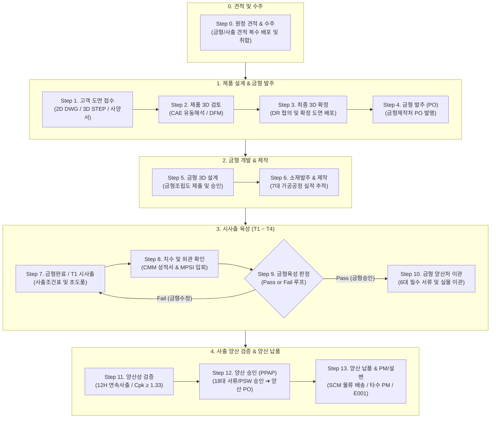

# [KS X 9101-1:2025 표준 준수] MPSI 통합 제조·외주 SCM 플랫폼

> **MPSI (Manufacturing Product/Process Smart Integration)**는 고객사(원청) RFQ 접수 및 견적부터 제품 도면 접수, 금형 개발·제작, 시사출 육성, 사출 양산성 검증, PPAP 양산 승인, 양산 납품 및 금형 PM/설계변경까지 **전 제조 생애주기(Step 0 ~ Step 13, 총 14단계)를 통합 관제하는 차세대 스마트 제조 협업 SCM 포털 시스템**입니다.

---

## 📌 주요 기술 사양 및 표준 규격

* **국가 표준 규격 준수**: 산업통상자원부 국가기술표준원 **KS X 9101-1:2025** (제조분야 기업업무시스템 간 제조업무 데이터 교환 — 제1부: 데이터 모델) 및 최신 온톨로지 정의서 3종(`KSX9101-1_2025_온톨로지용v1.0_테이블정의서.xlsx`, `공통코드_워크시트.xlsx`, `온톨로지용v1.0.docx`) 100% 반영
* **[조건 1 충족] 표준/비표준 주석 완비**: DDL 및 코멘트 레벨에서 `[KS X 9101 표준]`, `[MPSI 실무 확장]`, `[MPSI 분산 연계]` 명확히 구분 표기
* **대소문자 보존 원칙**: 데이터베이스 테이블명 및 컬럼명의 대문자/소문자를 단 1글자의 변형도 없이 원본 그대로 보존 (PostgreSQL 인용 식별자 `"..."` Quoted Identifiers 필수 적용)
* **프레임워크 / 런타임**: **Next.js 16** (`^16.2.12`, App Router) + **React 19** (`19.2.4`) + **TypeScript 5**
* **빌드 / 번들러**: Next.js 고속 번들러 **Turbopack** (55개 라우트 무오류 정적 컴파일 완비)
* **스타일링 / UI**: **Tailwind CSS v4** (`@tailwindcss/postcss: ^4`, `tw-animate-css`) + **shadcn UI** + **Lucide React**
* **공식 Git 저장소**: `https://gitlab.a2lab.co.kr/jd/mpsi-dev.git` (메인 브랜치: `main`)

---

## 🏗️ 14단계 표준 제조 비즈니스 워크플로우 (Step 0 ~ Step 13)

MPSI 시스템은 자동차/전자 사출 플라스틱 부품 개발 시 복잡한 외주 제조 프로세스를 **선행 단계 완료 승인 기반의 14단계 상태 머신**으로 통제합니다.



### 단계별 상세 정의 및 주관 주체 (RACI)

| 단계 | 단계명 | 주관 주체 (Actor) | 핵심 입력 및 산출물 | 선행 조건 및 전이 규칙 |
| :---: | :--- | :--- | :--- | :--- |
| **Step 0** | **원청 견적 & 수주** | MPSI (영업/개발) | 원청 RFQ, 외주 금형/사출 견적서, 공식 견적서 | 임시 관리번호 `Q26001-01` 부여 ➔ 수주 확정 시 정식 번호 `MI26001P0` 승격 |
| **Step 1** | **제품 data 접수** | MPSI (개발팀) | 2D 도면(`DWG`/`PDF`), 3D 모델(`STEP`), 사양서 | `SalesOrder` 테이블 연계 3대 도면 파일 업로드 (`FileUploader`) |
| **Step 2** | **제품 3D data 검토** | MPSI 기술팀 | CAE 유동해석 보고서(Moldflow), DFM 검토서 | 고객사에 제품 살두께/빼기고배 수정 DR 피드백 |
| **Step 3** | **최종 3D data 수신** | MPSI 기술팀 | 최종 확정 CAD 모델(`STEP`), DR 합의 회의록 | 고객사 승인 확정 도면 배포 및 잠금(Lock) |
| **Step 4** | **금형 발주 (PO)** | MPSI 구매팀 | 금형 제작 발주서(PO), 금형 제작 사양서, 목표 T1 | 우성정공 등 금형제작처로 정식 PO 발행 |
| **Step 5** | **금형 설계** | 금형제작처 ➔ MPSI | 금형 3D 조립도(STP), 2D 가공도면, 검도 체크리스트 | 금형사 설계 등록 ➔ MPSI 기술팀 검도 및 승인 |
| **Step 6** | **소재발주 및 제작** | 금형제작처 | 7대 공정 진행표(건드릴, 밀링, 열처리, CNC, 방전, 래핑, 조립) | 코어 강재 선발주 승인 및 7대 가공 공정률 추적 |
| **Step 7** | **금형완료 / 시사출 (T1)** | 금형제작처 | 사출조건표(온도/압력/CT), T1 결과보고서, 초도품 | 금형 조립 완료 후 금형사 사내 시사출 실시 |
| **Step 8** | **제품 치수/외관 확인** | MPSI & 금형사 | 3차원 CMM 치수성적서, 외관 품평서, 체크리스트 | MPSI 담당 엔지니어 현장 입회 검사 |
| **Step 9** | **금형 육성 판정** | MPSI 기술품질팀 | Pass 판정서 또는 수정 지시서(Fail) | **Pass**: Step 10 진행 / **Fail**: 금형수정(Step 7로 피드백 루프) |
| **Step 10** | **금형 양산처 이관** | 금형사 ➔ 사출사 | 6대 필수 서류(사출조건표, 조립도, 성적서 등) 및 금형 실물 | MPSI 승인 후 뉴몰드 등 사출양산처로 실물 및 데이터 이관 |
| **Step 11** | **양산성 검증** | 사출양산처 & MPSI | 12H 연속사출 결과서, 공정능력평가서(Cpk ≥ 1.33) | 양산 조건 검증 및 불량 발생 시 긴급 금형수정 연계 |
| **Step 12** | **양산 승인 (PPAP)** | MPSI & 고객사 | PPAP 18대 품질요건, 부품제출보증서(PSW) | 고객사 PSW 최종 승인 ➔ 양산 구매 발주(PO) 생성 |
| **Step 13** | **양산 납품 & PM/설변** | 사출양산처 | 납품 전표, SCM 배송 추적, PM 점검표, 설변 내역서 | 타수 기반 1~30차 PM 예방보전 및 E001 설변 관리 |

---

## 🔒 외주 협업 및 보안 격리 운영 지침 (Vendor Isolation Policy)

MPSI 시스템은 다자간 협업 환경에서 **영업 비밀 및 원가 정보 보호를 위해 엄격한 데이터 격리 규칙**을 적용합니다.

### 1. MPSI 본사의 견적 배포 운영 원칙
* **모든 등록 협력업체 자유 배포**: MPSI 관리자는 신규 견적 의뢰 시, 시스템에 등록된 모든 외주 협력사 목록(금형: 우성정공, 대한금형, 삼우정밀, 신영테크 등 / 사출: (주)뉴몰드, 세원사출, 제일프라테크, 한일엔프라 등)에서 **원하는 업체를 다중 체크하거나 `[✓ 전체 업체 일괄 배포]` 버튼으로 자유롭게 배포**할 수 있습니다.
* **자체 진행 지정**: `자체제작/자체생산` 선택 시 MPSI 사내 개발팀/공장 건으로 배정되며 외주 배포가 차단됩니다.

### 2. 외주 협력사 포털의 데이터 격리 원칙
* **자사 배정 건만 열람 가능**: 외주 협력사가 포털에 로그인하면, MPSI가 지정한 배포 대상 목록(`assignedVendors`)에 **자사가 포함되어 있거나 `전체 업체`로 배포된 건만 목록에 노출**됩니다.
* **경쟁사 단가 및 원가 정보 완전 차단**:
  * 테이블 견적가 열: 타사 단가는 비노출되며, **오직 자사가 제출한 견적가만 표시**됩니다.
  * 상세 모달: 자사 제출 단가, 자사 제출 4대 원가(재료비, 가공비, 관리비/이윤, 특수사양/물류비), 자사가 첨부한 견적서 파일만 표시됩니다.
  * 제출 이력 및 협의 메모: 자사가 차수별로 제출한 이력과 MPSI와의 1:1 대화 내용만 격리 노출됩니다.
* **타 부문 원가 마스킹**:
  * 금형 제작처(우성정공): 사출 양산 단가 및 원가 정보 열람 불가
  * 사출 양산처(뉴몰드): 금형 제작 원가 상세 내역 열람 불가
  * MPSI 본사: 전사 통합 원가, 목표 예산, 네고 이력 전권 열람

---

## 🏷️ 프로젝트 식별자 및 채번 관리 규칙

| 구분 | 채번 형식 | 예시 | 설명 및 상태 전이 규칙 |
| :--- | :--- | :--- | :--- |
| **견적 단계 (미수주)** | `Q{YY}{SEQ}-{DEG}` | `Q26001-01` | 원청 RFQ 접수 시 임시 관리번호 부여 |
| **수주 확정 (정식 프로젝트)** | `MI{YY}{SEQ}P{REV}` | `MI26001P0` | 원청 수주 계약 체결 시 정식 관리번호로 자동 승격 |
| **신작 개발** | `N{SEQ}` | `N001` | 최초 신규 제작 금형 및 사출 프로젝트 |
| **설계변경 (MCR)** | `E{SEQ}` | `E001`, `E002` | 설계변경 발생 시 개별 차수별 원가/도면/납기 분리 관리 |
| **금형 번호** | `MI{YY}{SEQ}M` | `MI26001M` | 금형 자산 고유 식별자 |
| **금형 차수** | `M{DEG}` | `M1`, `M2` | 금형 개조 및 차수 표기 |

> **복합 유니크 키(Composite Key)**: `"ProjectMaster"` 테이블은 **`("ProjectNo", "ChangeType")`**을 복합 유니크로 관리하여 신작(`N001`)과 설계변경(`E001`)이 동일 프로젝트 내에서 이력 단절 없이 공존하도록 설계되었습니다.

---

## 🗄️ 데이터베이스 아키텍처 (KS X 9101-1:2025 표준)

전체 데이터베이스 스키마는 **`Readme/`** 디렉터리의 정식 설계 문서 및 DDL 스크립트에 완전히 정의되어 있습니다:

* **[MPSI 데이터베이스 설계서 (`Readme/MPSI_DATABASE_DESIGN.md`)](./Readme/MPSI_DATABASE_DESIGN.md)**: 최신 온톨로지 76개 표준 + 20개 MPSI 실무 특화 + 3개 분산 연계 메타 테이블 (총 99개 테이블) 전체 명세서 및 Mermaid ERD
* **[PostgreSQL DDL 스크립트 (`Readme/mpsi_schema_ddl.sql`)](./Readme/mpsi_schema_ddl.sql)**: 인용 식별자(`"..."`), 테이블/컬럼 코멘트, 초기 시드 데이터를 포함한 410KB+ (총 99개 테이블, 1,650+ 컬럼) 완전 실행 스크립트
* **[역할 기반 권한 및 메뉴 구조 명세서 (`Readme/권한설정.md`)](./Readme/권한설정.md)**: MPSI 본사, 우성정공, 뉴몰드 역할별 메뉴 완전 격리 및 RBAC 명세서
* **[아크포지(ArcForge) AI 자동 컨버팅 명세서 (`Readme/ARCFORGE_CONVERSION_SPEC.md`)](./Readme/ARCFORGE_CONVERSION_SPEC.md)**: 아크포지 플랫폼 AI 자동 변환 아키텍처 매핑 지침 및 전용 프롬프트
* **[PostgreSQL 세팅 및 실무 운영 종합 가이드 (`Readme/README.md`)](./Readme/README.md)**: 데이터베이스 구축 세부 지침서

### 핵심 테이블 구조 요약

```
[표준 마스터 그룹]
├── "Enterprise" / "Plant" / "Department" / "Employee" (조직 마스터)
├── "CustomerMaster" / "VendorMaster" (거래처 마스터)
└── "ItemMaster" / "MoldMaster" (품목 및 금형 자산 마스터)

[수주 및 도면 접수 그룹]
└── "SalesOrder" (원청 수주 및 2D DWG, 3D STEP, 사양서 등 20개 신규 도면 컬럼 완비)

[14단계 워크플로우 그룹]
├── "ProjectMaster" (14단계 상태 머신, N001/E001 복합키)
├── "MpsiMoldQuotation" / "MpsiMassProductionQuotation" (외주 견적 배포 및 격리)
├── "MpsiMoldDesign" / "MpsiMoldManufacture" (금형 설계 및 7대 가공 공정)
├── "MpsiMoldTrial" (T1~T4 시사출 육성 및 Pass/Fail 판정)
├── "MpsiMoldTransfer" (Step 10 6대 필수서류 및 금형 양산처 이관)
├── "MpsiMassProductionValidation" / "MpsiUrgentMoldRevision" (12H 연속사출 및 긴급수정)
├── "MpsiPpapMaster" (PPAP 18대 품질서류 및 PSW 승인)
└── "MpsiDeliveryShipment" / "MpsiPmRevisionMaster" (SCM 배송 및 1~30차 PM)

[공통 협업 그룹]
├── "MpsiProjectStepAttachment" (공통 FileUploader 연계 단계별 첨부파일)
├── "MpsiProjectStepMemo" (공정별 실무 메모)
└── "MpsiNotification" (영구 보존 업무 알림망)
```

---

## 📁 프로젝트 디렉터리 구조 및 라우팅 맵 (55개 라우트)

```
MPSI/
├── Readme/                               # KS X 9101-1 표준 및 DB 구축 문서
│   ├── KSX9101-1_2025_온톨로지용v1.0_테이블정의서.xlsx # 최신 76개 표준 테이블 정의서 원본
│   ├── KSX9101-1_2025_온톨로지용v1.0_공통코드_워크시트.xlsx # 표준 공통코드 워크시트
│   ├── KSX9101-1_2025_온톨로지용v1.0.docx         # 온톨로지 데이터 모델 규격서
│   ├── KSX9101-1_20250926.pdf                     # 국가기술표준원 표준 원본
│   ├── MPSI_DATABASE_DESIGN.md          # 전체 테이블 상세 명세서
│   ├── mpsi_schema_ddl.sql              # PostgreSQL DDL 스크립트
│   └── README.md                        # PostgreSQL 세팅 가이드
├── src/
│   ├── app/
│   │   ├── portal/
│   │   │   ├── project/                 # [MPSI] 14단계 프로젝트 종합 관제 (Step 0~13)
│   │   │   ├── sales-order/             # [MPSI] 고객 도면 접수 (SalesOrder 3대 파일)
│   │   │   ├── mold-dev/                # [MPSI] 금형 개발 (견적/설계/제작/시사출)
│   │   │   ├── mass-prod/               # [MPSI] 사출 양산 (견적/검증/PPAP/출하)
│   │   │   ├── outsourcing/             # [MPSI] 외주 발주 및 입고 관리
│   │   │   ├── basic-info/              # [MPSI] 기준정보 (고객사/협력사/품목/공정/창고/사원)
│   │   │   ├── delivery-status/         # [MPSI] SCM 운송 배송 관제
│   │   │   └── vendor-portal/           # [외주 협력사 포털]
│   │   │       ├── mold/                # 금형제작처 (견적/프로젝트/설계/제작/육성/PM)
│   │   │       └── mass/                # 사출양산처 (견적/프로젝트/시양산/PPAP/출하/PM)
│   ├── components/
│   │   ├── common/
│   │   │   ├── file-uploader.tsx        # 공통 첨부파일 업로더 (드래그앤드롭/Blob/다운로드)
│   │   │   └── date-range-filter.tsx    # 기간 프리셋 필터 (1주/1개월/3개월/1년/전체)
│   │   ├── layout/
│   │   │   └── notification-center.tsx  # 영구 보존 업무 알림 센터
│   │   ├── role-switcher.tsx            # 실시간 MPSI ↔ 외주사 역할 전환기
│   │   └── app-sidebar.tsx              # 역할 기반 동적 메뉴 사이드바
│   ├── lib/                             # 로컬 스토리지 상태 머신 및 스토어
│   └── types/
│       └── ksx9101.ts                   # KS X 9101-1:2025 표준 TypeScript 타입 정의
├── package.json
└── README.md
```

---

## 🚀 설치 및 실행 가이드

### 1. 요구 사항
* **Node.js**: `v20.x` 이상 (권장: `v22.x LTS`)
* **패키지 매니저**: `npm` (`v10.x` 이상) 또는 `pnpm`
* **Git**: `2.30+`

### 2. 로컬 개발 환경 실행

```bash
# 1. 저장소 클론 (새 GitLab 저장소)
git clone https://gitlab.a2lab.co.kr/jd/mpsi-dev.git
cd mpsi-dev

# 2. 의존성 패키지 설치
npm install

# 3. 로컬 개발 서버 시작 (Turbopack)
npm run dev
```

브라우저에서 `http://localhost:3000` 접속 후, 화면 상단 우측의 **역할 전환기(Role Switcher)**를 클릭하여 다음 역할을 전환하며 시뮬레이션할 수 있습니다:
* **MPSI 본사 관리자** (`MPSI 본사 김민수 총괄이사`)
* **금형 협력사** (`우성정공(주) 배희섭 수석`)
* **사출 협력사** (`(주)뉴몰드 최진호 팀장`)

### 3. 전체 프로덕션 빌드 검증

```bash
npm run build
```
> Turbopack 컴파일 및 전체 TypeScript 타입 검사를 수행하여 55개 라우트 전체가 100% 정상 정적 빌드되는지 확인합니다.

### 4. Git 작업 및 협업 규칙

* **기본 원격 저장소**: `origin` (`https://gitlab.a2lab.co.kr/jd/mpsi-dev.git`)
* **기본 작업 브랜치**: `main`
* 코드 수정 후 커밋 및 푸시:
  ```bash
  git add .
  git commit -m "feat: [기능명] 작업 내용 요약"
  git push origin main
  ```

---

## 📜 라이선스 및 저작권
본 시스템의 소스 코드, 데이터베이스 모델링 및 비즈니스 프로세스 설계 산출물은 **MPSI 프로젝트**의 고유 자산이며, 국가기술표준원 **KS X 9101-1:2025** 데이터 모델 표준을 준수합니다.
