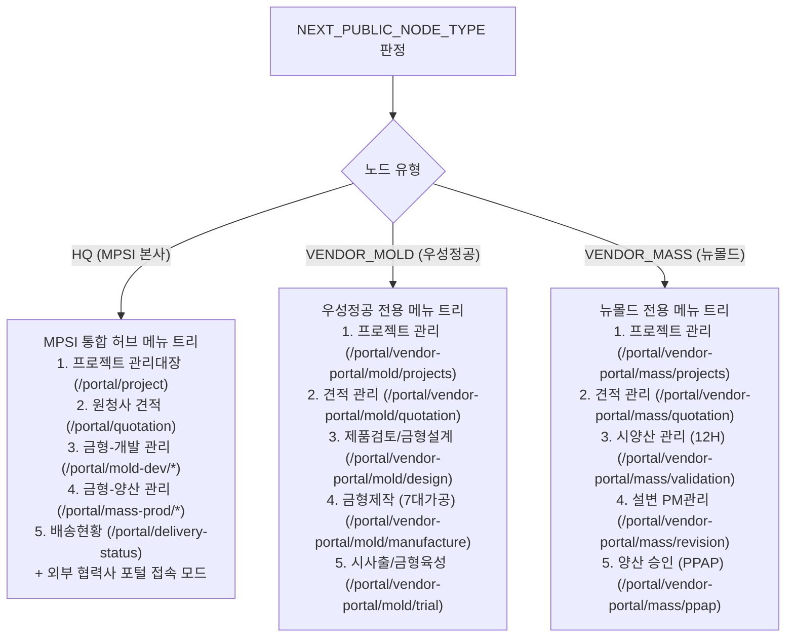

# [MPSI] 아크포지(ArcForge) 플랫폼 AI 자동 컨버팅 명세서 (Conversion Specification)

> **문서 버전:** v1.0.0 (2026-10-22)  
> **프로젝트 성격:** 정부 과제 사출 금형 개발 및 양산 협업 시스템  
> **변환 목적:** 현재 Next.js 16 기반의 MPSI 단일 코드베이스 시스템을 **아크포지(ArcForge) 로우코드/마이크로서비스 플랫폼**으로 AI를 통해 자동 컨버팅하기 위한 공식 기술 명세서  
> **대상 독자:** AI 코드 변환 엔진, 시스템 아키텍트, 아크포지 플랫폼 엔지니어  

---

## 1. 아크포지(ArcForge) AI 컨버팅 개요

본 MPSI 시스템은 **정부 과제 실증 요건**에 따라 다음 핵심 구조를 완비하고 있으며, 아크포지 플랫폼의 엔티티, 워크플로우 엔진, 마이크로서비스로 1:1 무손실 매핑이 가능하도록 표준화되었습니다:

1. **단일 소스코드 기반 3사 독립 배포 (Multi-Node Deployment):**
   - MPSI 본사 (`NODE_TYPE=HQ`): 14단계 전 공정 총괄 관제 + 중소 협력사용 웹 포털
   - 우성정공(주) (`NODE_TYPE=VENDOR_MOLD`): 금형제작 전용 독립 시스템 (본사 메뉴 완전 격리)
   - (주)뉴몰드 (`NODE_TYPE=VENDOR_MASS`): 사출양산 전용 독립 시스템 (금형/본사 메뉴 완전 격리)
2. **분산 독립 DB 간 API 연계 (Transactional Outbox Pattern):**
   - 각 사 독립 PostgreSQL DB (총 112개 관리 테이블)
   - `MpsiSyncOutbox`, `MpsiSyncInbox`, `MpsiSyncNodeRegistry`를 통한 멱등성 보장 비동기 연계
3. **KS X 9101-1:2025 표준 준수:**
   - 대소문자 보존 인용 식별자(`"..."`), 1,770+ 컬럼 스키마 및 코멘트 완비

---

## 2. 핵심 변환 산출물 맵 (Machine-Readable Artifacts)

아크포지 AI 변환기는 아래 산출물을 입력으로 사용하여 플랫폼 리소스를 자동 프로비저닝합니다:

| 산출물 파일 | 유형 | 아크포지 변환 대상 |
| :--- | :---: | :--- |
| **[`src/config/arcforge-manifest.json`](../src/config/arcforge-manifest.json)** | JSON 매니페스트 | 아크포지 프로젝트 루트 메타데이터, 노드 토폴로지, 권한 트리 |
| **[`src/config/openapi-spec.json`](../src/config/openapi-spec.json)** | OpenAPI 3.0 | 아크포지 API Gateway 엔드포인트 및 SDK 클라이언트 |
| **[`Readme/mpsi_schema_ddl.sql`](./mpsi_schema_ddl.sql)** | PostgreSQL DDL | 아크포지 Data Entity Models (112개 테이블 1:1 매핑) |
| **[`Readme/MPSI_DATABASE_DESIGN.md`](./MPSI_DATABASE_DESIGN.md)** | DB 설계서 | 아크포지 데이터 사전 및 ERD 관계 매핑 |
| **[`Readme/권한설정.md`](./권한설정.md)** | RBAC 명세서 | 아크포지 Role & Navigation Menu 권한 매트릭스 |
| **[`src/services/sync-service.ts`](../src/services/sync-service.ts)** | 서비스 레이어 | 아크포지 Backend Service Functions / Worker Pipelines |

---

## 3. 노드별 메뉴 및 화면 매핑 규칙 (Zero-Exposure)

아크포지 UI 엔진으로 변환할 때, 각 배포 인스턴스는 아래 매핑 규칙에 따라 메뉴 트리를 구성해야 합니다:



> **원칙:** 외주업체 독립 설치 노드에서는 타 역할 메뉴가 DOM 트리에 렌더링되거나 라우팅되어서는 안 됩니다.

---

## 4. 데이터베이스 및 분산 연계 변환 규칙

### 4.1 Quoted Identifiers 보존
- PostgreSQL DDL의 모든 큰따옴표 인용 식별자(`"ItemMaster"`, `"ItemId"`, `"CreationDateTime"` 등)는 아크포지 엔티티의 필드명에 **대소문자 그대로 유지**되어야 합니다 (snake_case 변환 금지).

### 4.2 7대 분산 연계 이벤트 매핑

| 이벤트 코드 (`eventType`) | 발신 노드 | 수신 노드 | 아크포지 워크플로우 매핑 |
| :--- | :---: | :---: | :--- |
| **`MOLD_ORDER_DISPATCHED`** | MPSI_HQ | WOOSUNG_MOLD | 금형 발주 확정 ➔ 우성정공 신규 금형 프로젝트 생성 및 3D 모델 다운로드 파이프라인 |
| **`MOLD_PROGRESS_UPDATED`** | WOOSUNG_MOLD | MPSI_HQ | 우성정공 7대 가공 공정률 저장 ➔ MPSI 통합 관제 대시보드 공정률 동기화 |
| **`MOLD_TRIAL_SUBMITTED`** | WOOSUNG_MOLD | MPSI_HQ | T1 시사출 성적서 제출 ➔ MPSI 입회검사 및 Pass/Fail 판정 워크플로우 트리거 |
| **`MASS_ORDER_DISPATCHED`** | MPSI_HQ | NEWMOLD_MASS | 사출 의뢰 확정 ➔ 뉴몰드 신규 양산 수주 프로젝트 생성 |
| **`MASS_VALIDATION_REPORTED`**| NEWMOLD_MASS | MPSI_HQ | 12H 연속사출 결과 등록 ➔ MPSI/우성정공 Cpk 공정능력 심사 워크플로우 |
| **`MASS_PPAP_SUBMITTED`** | NEWMOLD_MASS | MPSI_HQ | PPAP 18대 품질서류 제출 ➔ MPSI 품질본부 PSW 승인 심사 요청 |
| **`MASS_PPAP_APPROVED`** | MPSI_HQ | NEWMOLD_MASS | PSW 승인 확정 ➔ 뉴몰드 완제품 양산 PO 발급 및 양산 착수 |

---

## 5. 🤖 타 AI 대상 아크포지(ArcForge) 컨버팅 프롬프트 템플릿

다른 AI 모델(Claude, GPT, Gemini 등)에게 본 저장소를 아크포지로 변환하도록 요청할 때 아래 프롬프트를 복사하여 전달하십시오:

````markdown
# [Task] MPSI 스마트 제조 포털의 아크포지(ArcForge) 플랫폼 자동 컨버팅

당신은 아크포지(ArcForge) 플랫폼 아키텍처 및 코드 변환 전문 AI입니다.
첨부된 MPSI 저장소는 정부 과제 요건에 따라 **MPSI 본사, 우성정공(금형외주), 뉴몰드(양산외주)** 3개 사에 각각 단일 소스코드로 배포되며, 독립 DB 간 API 연계를 수행하는 하이브리드 분산 협업 시스템입니다.

다음 지침과 사양서를 엄격히 준수하여 아크포지 플랫폼 네이티브 코드로 변환하십시오:

### 1. 참조 필수 산출물
- 아크포지 매니페스트: `src/config/arcforge-manifest.json`
- OpenAPI 3.0 사양서: `src/config/openapi-spec.json`
- 데이터베이스 DDL: `Readme/mpsi_schema_ddl.sql` (112개 테이블)
- RBAC 메뉴 명세서: `Readme/권한설정.md`
- 분산 연계 서비스: `src/services/sync-service.ts`

### 2. 핵심 변환 규칙
1. **노드 정체성 분기:**
   - `NEXT_PUBLIC_NODE_TYPE` 값(`HQ`, `VENDOR_MOLD`, `VENDOR_MASS`)에 따라 사이드바 메뉴 및 라우트 접근을 물리적으로 격리하십시오.
2. **대소문자 보존 (KS X 9101-1:2025):**
   - 모든 엔티티 및 컬럼명은 원본 대소문자(`"ProjectMaster"`, `"ItemId"`, `"CreationDateTime"`)를 100% 보존해야 합니다.
3. **트랜잭셔널 아웃박스 연계:**
   - 7대 비즈니스 이벤트(`MOLD_ORDER_DISPATCHED`, `MOLD_PROGRESS_UPDATED` 등)는 `MpsiSyncOutbox`와 `MpsiSyncInbox`를 거쳐 멱등성(`IdempotencyKey`)을 보장하며 비동기 처리되도록 아크포지 파이프라인으로 구성하십시오.
4. **하이브리드 포털:**
   - MPSI 본사 인스턴스(`HQ`)에서는 자체 서버가 없는 중소 외주사가 웹 브라우저로 직접 접속하여 외주업체 권한으로 동일한 업무를 수행할 수 있도록 지원하십시오.
````

