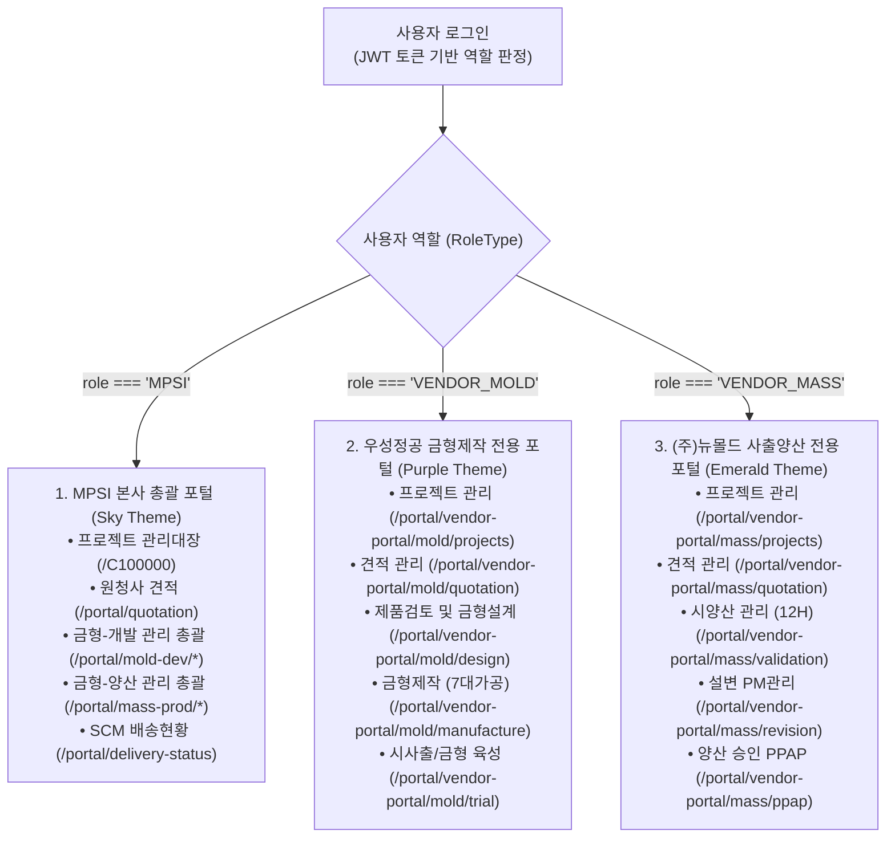
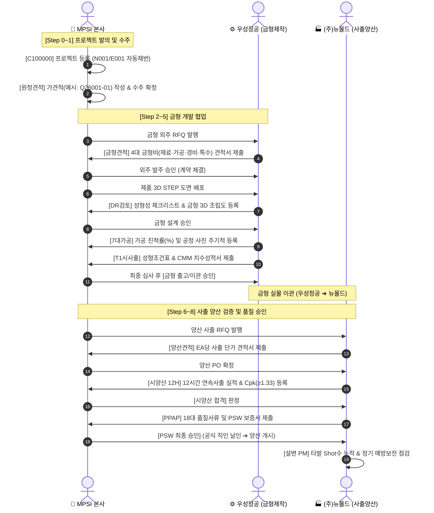

# [MPSI × ArcForge] 스마트 제조 포털 역할별 CRUD 운영 매뉴얼 및 업무 가이드

> **문서 버전:** v3.1.0 (2026-11-01)  
> **시스템명:** MPSI 사출 금형 개발 및 양산 협업 포털 (ArcForge 마이그레이션 통합판)  
> **접속 URL:** `https://mpsi-scm-v2.a2lab.co.kr`  
> **대상 독자:** MPSI 본사 총괄 관리자, 우성정공(금형 외주사), (주)뉴몰드(사출 양산 외주사), 후속 AI 및 개발자

> [!IMPORTANT]
> **[필독] 식별자 코드 및 번호 표기 원칙 (모든 ID는 "예시" 데이터입니다)**  
> 본 문서에 기재된 모든 프로젝트 번호(`MI26001P0`, `MI26009P0` 등), 견적번호(`Q26001-01`, `Q26009-01` 등), 금형번호(`MI26001M`, `MI26009M` 등), 품번(`84710-NT500-LH` 등), 운송번호(`TRK-260101` 등)는 동작 원리를 설명하기 위한 **"예시(Sample / Example)" 데이터**입니다.  
> **다른 AI 모델이나 개발자/사용자는 특정 번호를 고정값(하드코딩)으로 간주하거나 그대로 사용해서는 안 됩니다.**  
> 시스템은 연도(`yy`), 당해연도 순번(`NNN`), 부모 프로젝트 차수(`-E00n`)에 따라 동적으로 자동 채번하는 프로시저 규칙(`PROC_PROJECTMASTER_SAVE`)을 따릅니다:
> - **신작 프로젝트 채번 규칙**: `MI` + `{연도2자리}` + `{순번3자리}` + `P0`  
>   *(예시: 26년도 9번째 등록 시 ➔ `MI26009P0`)*
> - **신작 견적번호 채번 규칙**: `Q` + `{연도2자리}` + `{순번3자리}` + `-{차수2자리}`  
>   *(예시: `Q26009-01`)*
> - **신작 금형번호 채번 규칙**: `MI` + `{연도2자리}` + `{순번3자리}` + `M`  
>   *(예시: `MI26009M`)*
> - **설변 프로젝트 채번 규칙**: `{부모ProjectID}` + `-E` + `{차수3자리}`  
>   *(예시: 부모가 `MI26001P0`이고 3차 설변 시 ➔ `MI26001P0-E003`)*
> - **설변 견적번호 채번 규칙**: `{부모견적베이스}` + `-{차수2자리증가}`  
>   *(예시: 부모 견적이 `Q26001-01`이면 3차 설변 시 ➔ `Q26001-04`)*

---

## 1. 역할(Role) 구분 및 제로 노출(Zero-Exposure) 원칙

본 협업 포털은 **MPSI 본사, 금형제작 외주사(우성정공), 사출양산 외주사((주)뉴몰드)** 3개 조직이 단일 플랫폼에서 협업하도록 설계되었으며, **로그인한 사용자의 역할(Role)에 따라 메뉴 구조가 물리적으로 분기**됩니다.



### [보안 철칙] 역할별 메뉴 제로 노출 원칙 (Zero-Exposure)
1. **타사 데이터 및 메뉴 차단**: 우성정공 계정으로 접속 시 사출양산 메뉴나 타 협력사 프로젝트가 DOM 트리에 렌더링조차 되지 않으며, 뉴몰드 계정으로 접속 시 금형 7대 가공 메뉴가 원천 차단됩니다.
2. **목표 수주가 절대 보안**: MPSI 본사의 내부 목표 수주예산(`targetBudgetWon`)은 외주 협력사 화면 어디에도 노출되지 않습니다.
3. **자사 배정 건만 조회**: 협력사는 MPSI가 자사에 정식으로 배정한 프로젝트만 조회/작업할 수 있습니다.

---

## 2. 3자 협업 엔드투엔드(End-to-End) 업무 흐름도



---

## 3. [MPSI 본사] 총괄 관리자 메뉴 상세 CRUD 가이드

---

### [MPSI 1] 프로젝트 관리대장 (`/C100000`)
> **역할**: 전 공정(0~13단계)의 마스터 키(`ProjectID`)를 생성하고 상태를 통합 관제하는 최상위 화면

```
┌────────────────────────────────────────────────────────────────────────────────────────┐
│ [상단 검색영역]                                                                        │
│  조회기간 [ 전체 ▼ ]  검색어 [ 프로젝트코드/명 ]  구분 [ 전체 ▼ ]  고객사 [ 전체 ▼ ]     [검색]│
├────────────────────────────────────────────────────────────────────────────────────────┤
│ [그리드 툴바]                                                                          │
│  2.34 전체 프로젝트 통합 관리대장       [0-13단계 히스토리]  [+ 신규 프로젝트 등록]  [수정]     │
├────────────────────────────────────────────────────────────────────────────────────────┤
│ [프로젝트 총괄 그리드 (아래 번호 및 데이터는 모두 예시입니다)]                         │
│  Idx │ 프로젝트 번호 (예시)  │ 견적번호 (예시) │ 구분  │ 고객사   │ 프로젝트명 │ 금형번호(예시)│
│  ○ 1 │ MI26001P0 (예시)     │ Q26001-01(예시)│ N001  │ 현대자동차│ Front Door │ MI26001M(예시)│
│  ○ 2 │ MI26001P0-E001 (예시)│ Q26001-02(예시)│ E001  │ 현대자동차│ Front Door │ MI26001M(예시)│
│  ● 3 │ MI26001P0-E003 (예시)│ Q26001-04(예시)│ E001  │ 현대자동차│ Front Door │ MI26001M(예시)│
└────────────────────────────────────────────────────────────────────────────────────────┘
```

#### 1. [C - Create] 신규 프로젝트 등록
* **진입 경로**: 그리드 상단 툴바 우측 **`[+ 신규 프로젝트 등록]`** 버튼 클릭
* **호출 팝업**: `Dialog_C100000_REG` (프로젝트 등록 모달)
* **입력 항목 및 분기 규칙**:
  * **신작 (`N001`, 코드: `D335001`)**:
    * 완전히 새로운 신규 부품 개발 건.
    * `연동할 기존 프로젝트`: **선택하지 않고 빈칸 유지**.
    * `[저장]` 클릭 시 당해연도 순번 자동 채번:
      * `ProjectID`: `MI26009P0 (예시: 연도별 최대 순번 + 1)`
      * `OfficialProjectID`: `MI26009P0 (예시)` 동일 부여
      * `EstimateNumber`: `Q26009-01 (예시)`
      * `MoldNumber`: `MI26009M (예시)`
  * **설변 (`E001`, 코드: `D335002`)**:
    * 기존 진행 중인 금형의 도면 변경 건.
    * `연동할 기존 프로젝트`: 드롭다운(`VIEW_PROJECT_LOOKUP`)에서 **모 프로젝트를 필수 선택** *(예시: `[MI26001P0] Front Door Upper Cover`)*.
    * `[저장]` 클릭 시 부모 하위 최대 차수를 계산하여 자동 채번:
      * `ProjectID`: 부모-최대차수+1 *(예시: 기존 E002 선점 시 `MI26001P0-E003`으로 자동 채번)*
      * `OfficialProjectID`: 부모 코드 `MI26001P0 (예시)` 그대로 유지 (그룹핑)
      * `EstimateNumber`: 부모 견적 차수 자동 증가 *(예시: `Q26001-04`)*
      * `MoldNumber`: 부모 금형번호(`MI26001M (예시)`) 자동 상속
* **저장 동작**: 모달 내 `[저장]` 클릭 ➔ `PROC_PROJECTMASTER_SAVE` 호출 ➔ 신규 행이 그리드에 즉시 추가됨.

#### 2. [R - Read] 조회 및 검색
* **검색 필터**: 기간(수주일/등록일), 검색어(프로젝트코드/명), 구분(N001/E001), 고객사, 외주사 콤보박스 선택 후 `[검색]` 클릭.
* **0-13단계 히스토리**: 행 선택 후 **`[0-13단계 히스토리]`** 클릭 ➔ 전체 공정 진행 타임라인 팝업 확인.

#### 3. [U - Update] 프로젝트 정보 수정
* **진입 경로**: 수정할 행의 라디오 버튼(○) 선택 ➔ 상단 **`[수정]`** 버튼 클릭 (전용 슬림 모달 오픈)
* **필드 제어 정책 (무결성 보호)**:
  * **[읽기 전용 잠금 (Disabled)]**: `프로젝트 번호`, `신작/설변 구분`, `견적번호`, `금형번호` (임의 수정 차단)
  * **[편집 가능 (Editable)]**: `프로젝트명`, `품번`, `일정 4종(Kick-off, T1, 양산승인, 납기)`, `비고(메모)`
* **저장 동작**: `[저장]` 클릭 ➔ 기존 데이터 유실 없이 수정한 항목만 안전하게 UPDATE 반영.

#### 4. [D - Delete] 삭제 정책
* **물리 삭제 금지**: 행 영구 삭제(`DELETE FROM`)는 불가하며, 오등록 건은 관리자 승인 하에 `FLAG='N'`(숨김) 처리, 수주 탈락 건은 비고에 사유를 기재하고 `상태=CANCEL`로 보존.

---

### [MPSI 2] 금형-견적관리 > 원청사 견적 (`/portal/quotation`)
* **[C - Create]**: 관리대장에서 생성된 가견적(`Q26001-01 (예시)`)을 매핑하여 목표 금형비 및 완제품 판가 견적서 신규 작성.
* **[R - Read]**: 원청사별/상태별 견적 현황 조회 및 인장이 날인된 공식 견적서 PDF 다운로드.
* **[U - Update]**: 원청사 네고 단가 수정 후 최종 낙찰 시 **`[수주 확정]`** 클릭 (프로젝트 1단계 승격).
* **[D - Delete]**: 탈락 시 `[수주 탈락]` 처리하여 영업 통계 데이터로 보존.

---

### [MPSI 3] 금형-개발 관리 총괄 (`/portal/mold-dev/*`)
* **금형 견적 승인 (`/mold-dev/quotation`)**: 우성정공이 제출한 4대 금형비를 검토하고 `[외주 발주 승인]` 클릭.
* **금형 설계 승인 (`/mold-dev/design`)**: 3D STEP 도면을 배포하고, 우성정공이 올린 DR 체크리스트와 금형 3D 조립도 검토 후 `[설계 승인]` 클릭.
* **7대 가공 모니터링 (`/mold-dev/manufacture`)**: 우성정공이 입력한 공정률과 현장 사진을 모니터링하여 납기 지연 방지.
* **시사출 육성 및 이관 승인 (`/mold-dev/trial`)**: T1 치수 성적서 검토 후 전 항목 합격 시 `[금형 출고/이관 승인]` 클릭 ➔ 뉴몰드로 금형 이관 결정.

---

### [MPSI 4] 금형-양산 관리 총괄 (`/portal/mass-prod/*`)
* **양산 단가 승인 (`/mass-prod/quotation`)**: 뉴몰드가 제출한 EA당 사출 단가를 검토하고 `[양산 단가 승인]` 클릭.
* **시양산 합격 판정 (`/mass-prod/validation`)**: 12H 연속 사출 데이터 및 $Cpk \ge 1.33$ 달성 여부를 확인하고 `[시양산 합격]` 클릭.
* **PPAP 최종 양산 승인 (`/mass-prod/ppap`)**: 18대 품질서류 완비성을 심사하고 **`[PSW 최종 양산 승인]`** 버튼을 클릭하여 공식 직인 날인 (0~13단계 개발 완료, 양산 이관).

---

### [MPSI 5] 배송현황 (`/portal/delivery-status`)
* 출하 시 생성된 배송 데이터(`TRK-260101 (예시)`)를 외부 물류사(소프트러쉬) API와 연동하여 이동 상태(상차 ➔ 운송 중 ➔ 배송 완료)를 종합 관제.

---

## 4. [우성정공 전용] 금형제작 외주 협력사 메뉴 상세 가이드

> **로그인 계정**: 우성정공 담당자 (`role: VENDOR_MOLD`)  
> **화면 테마**: Purple 테마 (금형 제작 전용 포털)

```
┌────────────────────────────────────────────────────────┐
│ [우성정공(주) 전용 사이드바 메뉴]                      │
│  📁 1. 프로젝트 관리        (/portal/vendor-portal/mold/projects)   │
│  📑 2. 견적 관리            (/portal/vendor-portal/mold/quotation)  │
│  📐 3. 제품검토 및 금형설계 (/portal/vendor-portal/mold/design)     │
│  🔨 4. 금형제작 (7대가공)   (/portal/vendor-portal/mold/manufacture)│
│  ⏱️ 5. 시사출/금형 육성     (/portal/vendor-portal/mold/trial)      │
└────────────────────────────────────────────────────────┘
```

---

### [우성정공 1] 프로젝트 관리 (`/portal/vendor-portal/mold/projects`)
* **[R - Read] 자사 배정 프로젝트 조회**:
  * MPSI 본사로부터 우성정공에 제작 배정된 금형 프로젝트 목록만 노출됩니다.
  * 프로젝트별 목표 T1일, 금형 납기일, 현재 공정 단계(설계/가공/시사출)를 조회합니다.
  * *(C/U/D 제한: 금형 프로젝트의 생성 및 삭제는 MPSI 본사 권한이며, 우성정공은 배정 건에 대한 조회 및 공정 수행만 가능합니다.)*

---

### [우성정공 2] 견적 관리 (`/portal/vendor-portal/mold/quotation`)
> **업무**: MPSI가 발행한 금형 제작 RFQ에 대해 4대 금형비를 산출하여 견적서를 제출하는 단계

* **[R - Read] 외주 RFQ 접수 확인**:
  * MPSI에서 발송한 금형 제작 사양서(수지 재질, 사출기 톤수, Cavity 수, 원판/코어 강재 사양)를 확인합니다.
* **[C/U - Create/Update] 4대 금형비 견적서 작성 및 제출**:
  1. 의뢰 건을 선택하고 `[견적서 작성]` 버튼을 클릭합니다.
  2. **4대 금형비 항목 입력**:
     * `재료비 (원)`: 몰드베이스(원판), 코어 강재, 유압 실린더 비용
     * `가공비 (원)`: CAM 가공, 방전, 와이어, 조립 공수 및 시간당 임률 계산
     * `경비 및 마진 (원)`: 설계비, 운송비, 일반관리비 및 이윤
     * `특수 사양비 (원)`: Hot Runner 시스템, 슬라이드 코어 특수 표면처리 비용
  3. 세부 원가 산출 근거 엑셀 파일을 첨부합니다.
  4. **`[견적 제출]`** 버튼을 클릭합니다.
* **[D - Delete] 제출 취소**:
  * MPSI가 '발주 승인'하기 전까지는 제출된 견적을 회수하거나 수정하여 재제출할 수 있습니다.

---

### [우성정공 3] 제품검토 및 금형설계 (`/portal/vendor-portal/mold/design`)
> **업무**: 원청 3D 도면을 다운로드하여 성형성을 사전 검토(DR)하고, 자사에서 설계한 금형 3D 조립도를 등록

* **[R - Read] 원본 3D 제품 도면 다운로드**:
  * MPSI가 업로드한 제품 3D CAD 파일(STEP/IGES)을 다운로드합니다.
* **[C - Create] 성형성 검토(DR) 체크리스트 등록**:
  * 다운로드한 도면을 분석한 후 **DR 체크리스트** 항목을 작성합니다:
    * 언더컷 발생 여부 및 슬라이드 코어 적용 방안
    * 빼기 구배(Draft Angle) 적정성 (기준: $1.5^\circ$ 이상)
    * 살두께 불균일에 따른 싱크마크(수축) 발생 가능 부위
    * 파팅 라인(PL) 및 게이트 위치 적합성
* **[C - Create] 금형 3D 조립도(STP) 업로드**:
  * 우성정공 설계팀에서 완성한 **금형 3D 어셈블리 모델(Assembly STP)** 파일을 업로드하고 `[설계 승인 요청]`을 클릭합니다.
* **[U - Update] 설계 보완**: MPSI 검토 후 수정 요청이 오면 2차 도면(Rev 1.1)으로 갱신 등록합니다.

---

### [우성정공 4] 금형제작 (7대 가공 진척) (`/portal/vendor-portal/mold/manufacture`)
> **업무**: 공장 현장의 7대 가공 공정 진척률(%)과 현장 사진을 주기적으로 등록하여 공유

* **[C/U - Create/Update] 7대 가공 공정별 실적 입력**:
  * 각 공정이 진행될 때마다 진행률(%)을 입력하고 현장 사진을 첨부합니다:
    1. **건드릴 가공 (0~100%)**: 냉각 홀 가공 깊이 및 누수 테스트 결과 등록
    2. **1차 밀링 가공 (0~100%)**: 몰드베이스 황삭 가공 상태
    3. **열처리 (0~100%)**: Core/Cavity 진공 열처리 후 경도(HRC) 성적서 첨부
    4. **고속 CNC 가공 (0~100%)**: 3차원 정삭 정밀 가공 실적
    5. **방전가공 (EDM) (0~100%)**: 미세 리브 및 문자 정밀 방전 실적
    6. **와이어 컷팅 (0~100%)**: 경사코어 및 인서트 분할 가공
    7. **랩핑 및 조립 (0~100%)**: 경면 사상 및 상·하원판 합형 조립 완료 사진
  * 하단의 **`[공정 실적 저장]`** 버튼을 클릭하면 MPSI 본사 관리대장에 최신 공정률이 즉시 동기화됩니다.

---

### [우성정공 5] 시사출 / 금형 육성 (`/portal/vendor-portal/mold/trial`)
> **업무**: 조립된 금형의 첫 시험 사출(T1 Trial)을 실시하고 성형조건표와 3차원 치수 성적서를 제출

* **[C - Create] T1 시사출 성형조건표 등록**:
  * 시험 사출기 제원(사출기 톤수, 스크류 직경) 입력
  * 세부 성형 조건 입력:
    * 수지 온도(Nozzle/Barrel), 금형 온도(고정측/가동측)
    * 사출 압력, 사출 속도, 보압(1~3차 압력 및 시간), 냉각 시간, 총 Cycle Time(초)
* **[C - Create] CMM 치수 측정 성적서 및 시편 사진 등록**:
  * 3차원 CMM 측정기로 전수 측정한 25개 주요 관리 치수 성적서(PDF/Excel) 업로드
  * 사출된 시편의 외관 사진(웰드라인, 수축, 가스자국 등) 업로드 후 **`[T1 성적서 제출]`** 클릭.
* **[U - Update] 금형 수정(육성) 대책서 등록**:
  * MPSI에서 치수 불합격(T2 지시) 판정이 내려질 경우, 금형 수정 계획(방전 재가공, 코어 덧살 등)을 입력하여 재제출합니다.

---

## 5. [(주)뉴몰드 전용] 사출양산 외주 협력사 메뉴 상세 가이드

> **로그인 계정**: (주)뉴몰드 담당자 (`role: VENDOR_MASS`)  
> **화면 테마**: Emerald 테마 (사출 양산 전용 포털)

```
┌────────────────────────────────────────────────────────┐
│ [(주)뉴몰드 전용 사이드바 메뉴]                        │
│  📁 1. 프로젝트 관리        (/portal/vendor-portal/mass/projects)   │
│  📑 2. 견적 관리            (/portal/vendor-portal/mass/quotation)  │
│  ⏱️ 3. 시양산 관리 (12H)    (/portal/vendor-portal/mass/validation) │
│  🔧 4. 설변 PM관리          (/portal/vendor-portal/mass/revision)   │
│  📋 5. 양산 승인 (PPAP)     (/portal/vendor-portal/mass/ppap)       │
└────────────────────────────────────────────────────────┘
```

---

### [뉴몰드 1] 프로젝트 관리 (`/portal/vendor-portal/mass/projects`)
* **[R - Read] 자사 배정 사출 프로젝트 조회**:
  * MPSI 본사로부터 뉴몰드에 양산 배정된 프로젝트 목록을 조회합니다.
  * 목표 양산 승인일, 양산 착수(SOP) 일정, 금형 이관 입고 상태를 확인합니다.

---

### [뉴몰드 2] 견적 관리 (`/portal/vendor-portal/mass/quotation`)
> **업무**: 수지 원재료비, 사출 임가공비, 포장물류비를 산출하여 완제품 개당(EA) 양산 단가 견적을 제출

* **[R - Read] 양산 사출 RFQ 접수**:
  * MPSI가 전달한 제품 스펙, 연간 예상 생산량(EAU), 포장 사양을 확인합니다.
* **[C/U - Create/Update] 사출 단가 견적서 제출**:
  1. 부품을 선택하고 `[양산 단가 입력]` 클릭.
  2. **원가 세부 항목 산출 입력**:
     * `수지비 (원/EA)`: 원료 단가($/kg) $\times$ 제품 중량(g) $\times$ 스프루/러너 손실률(%)
     * `사출 임가공비 (원/EA)`: 사출기 톤수별 시간당 임률 $\div$ 시간당 생산량(C/T 반영)
     * `포장 및 운송비 (원/EA)`: 완제품 트레이/박스 포장비 및 고객사 납품 운반비
     * `관리비 및 이윤`: 총 원가 대비 마진율(%)
  3. 개당 최종 제안 단가를 확인하고 **`[양산 견적 제출]`** 버튼을 클릭합니다.

---

### [뉴몰드 3] 시양산 관리 (12H 연속 사출) (`/portal/vendor-portal/mass/validation`)
> **업무**: 이관받은 금형을 사출기에 안착하고, 12시간 연속 사출을 통해 양산 안정성 및 공정능력($Cpk$)을 검증

* **[C - Create] 12시간 연속 사출 실적 등록**:
  1. 양산 사출기에 금형을 체결하고 사출 조건을 셋업합니다.
  2. 12시간 동안 연속 사출을 가동하며 실적 데이터를 입력합니다:
     * `총 가동 시간`: 12시간 (720분)
     * `총 생산 Shot수`, `양품 수량`, `불량 수량`
     * `불량 유형별 분류`: 미성형(Short Shot), 바리(Flash), 흑점, 휨(Warpage) 등
* **[C - Create] 25개 샘플 치수 측정값 입력 & $Cpk$ 자동 산출**:
  * 연속 사출 중 일정 주기마다 추출한 25개 샘플의 핵심 관리 치수 측정값을 입력합니다.
  * **시스템 자동 계산**: 데이터 입력 즉시 평균($\bar{X}$), 표준편차($\sigma$), **공정능력지수($Cpk$)가 시스템에서 자동으로 산출**됩니다.
  * 산출된 $Cpk$ 값이 양산 적합 기준인 **$1.33$ 이상**인지 확인하고 **`[12H 실적 보고]`**를 클릭합니다.
* **[R - Read] 공정능력 트렌드 차트**: 정규분포 곡선 및 관리 상/하한선(USL/LSL) 이탈 여부 그래프 조회.

---

### [뉴몰드 4] 설변 PM 관리 (`/portal/vendor-portal/mass/revision`)
> **업무**: 금형의 누적 타발 Shot수를 관리하고, 1만/5만/10만/30만회 정기 예방보전(PM) 점검표 작성 및 E001 설변 이력 관리

* **[C/U - Create/Update] 금형 타발 Shot수 누적 기록**:
  * 일일 사출 완료 후 금형의 누적 Shot수를 갱신합니다.
* **[C - Create] 정기 예방보전(PM) 점검 일지 등록**:
  * 누적 Shot수에 도달했을 때 정기 점검을 실시하고 체크리스트를 등록합니다:
    * `1만 Shot 점검`: 파팅면 세척, 가이드핀 급유, 가스빼기 라인 청소
    * `5만 Shot 점검`: 슬라이드 코어 마모도 측정, 냉각 라인 세척 및 누수 점검
    * `10만 Shot 점검`: 코어/캐비티 형상 마모도 검사, 이젝터 핀 유격 점검
    * `30만 Shot 점검`: 금형 오버홀(완전 분해 소제) 및 주요 인서트 코어 교체
* **[R - Read] 설변(E001) 이력 추적**:
  * 해당 금형에 설계 변경이 발생했을 때, 변경 전/후 금형 개조 내역과 변경된 파트의 Shot수 분기점을 추적 조회합니다.

---

### [뉴몰드 5] 양산 승인 (PPAP 승인) (`/portal/vendor-portal/mass/ppap`)
> **업무**: 완성차/원청사 요구 수준의 PPAP 18대 품질보증 서류를 등록하고 부품제출보증서(PSW) 승인을 요청

* **[C - Create] PPAP 18대 품질 서류 업로드**:
  * 완성차 품질 기준에 부합하는 서류 파일을 일괄 등록합니다:
    1. 부품제출보증서 (PSW: Part Submission Warrant)
    2. 초도품 검사 성적서 (ISIR)
    3. 공정 흐름도 (Process Flow Chart)
    4. 공정 FMEA (PFMEA)
    5. 관리계획서 (Control Plan)
    6. 측정시스템 분석 (Gage R&R)
    7. 치수 측정 결과서
    8. 재료 및 성능 시험 결과서 등 18대 서류
* **[C - Create] PSW 승인 요청**:
  * 뉴몰드 공장장 직인이 날인된 PSW 초안을 첨부하여 MPSI 본사 품질팀으로 **`[PSW 승인 요청]`**을 전송합니다.
* **[R - Read] 승인 상태 확인**:
  * MPSI 본사의 심사 상태(검토 중 ➔ 보완 요청 ➔ 최종 승인 완료)를 즉시 확인합니다.
  * 최종 승인이 완료되면 **MPSI 공식 직인이 날인된 최종 양산 승인서(PSW 완료본)**를 다운로드할 수 있습니다.
* **[D - Delete] 영구 보존**: 자동차 품질 규정에 따라 업로드된 PPAP 서류는 절대 삭제할 수 없습니다.

---

## 6. 역할별 화면 및 업무 매핑 매트릭스 (종합표)

| 프로세스 단계 | 세부 업무 내용 | 🏢 MPSI 본사 화면 | ⚙️ 우성정공 (금형) 화면 | 🏭 (주)뉴몰드 (사출) 화면 |
| :--- | :--- | :--- | :--- | :--- |
| **0. 프로젝트 발의** | 14단계 전체 마스터키 생성 & 자동채번 | `/C100000` (관리대장) | `/vendor-portal/mold/projects` (조회) | `/vendor-portal/mass/projects` (조회) |
| **1. 원청사 견적** | 고객사 제출용 견적서 작성 & 수주확정 | `/portal/quotation` | *(접근 차단)* | *(접근 차단)* |
| **2. 금형 외주 견적** | 4대 금형비 산출 & 외주 발주 계약 | `/portal/mold-dev/quotation` | `/vendor-portal/mold/quotation` (제출) | *(접근 차단)* |
| **3. 도면 및 설계** | 제품 3D 배포, DR체크리스트, 조립도 승인 | `/portal/mold-dev/design` | `/vendor-portal/mold/design` (DR/조립도) | *(접근 차단)* |
| **4. 금형 7대 가공** | 건드릴~조립 공정률 등록 & 모니터링 | `/portal/mold-dev/manufacture`| `/vendor-portal/mold/manufacture` (입력) | *(접근 차단)* |
| **5. 시사출/금형육성**| T1 사출조건표, CMM 치수검사, 이관승인 | `/portal/mold-dev/trial` | `/vendor-portal/mold/trial` (성적서제출)| *(금형 입고 대기)* |
| **6. 양산 외주 견적** | 사출 임가공/원재료 단가 산출 & PO 체결 | `/portal/mass-prod/quotation` | *(접근 차단)* | `/vendor-portal/mass/quotation` (제출) |
| **7. 시양산 (12H)** | 금형 안착, 12H 연속사출, $Cpk$ 검증 | `/portal/mass-prod/validation`| *(접근 차단)* | `/vendor-portal/mass/validation` (입력) |
| **8. 설변 PM 관리** | 금형 누적타발 Shot수, 예방보전 점검 | `/portal/mass-prod/validation`| *(수정금형 제작 시)* | `/vendor-portal/mass/revision` (점검일지) |
| **9. 양산 승인(PPAP)**| 18대 품질서류 심사 & 최종 PSW 직인 | `/portal/mass-prod/ppap` | *(접근 차단)* | `/vendor-portal/mass/ppap` (서류제출) |
| **10. SCM 배송현황** | 출하부터 고객사 도착까지 물류 관제 | `/portal/delivery-status` | 배송 출발 확인 | 배송 도착 확인 |

---