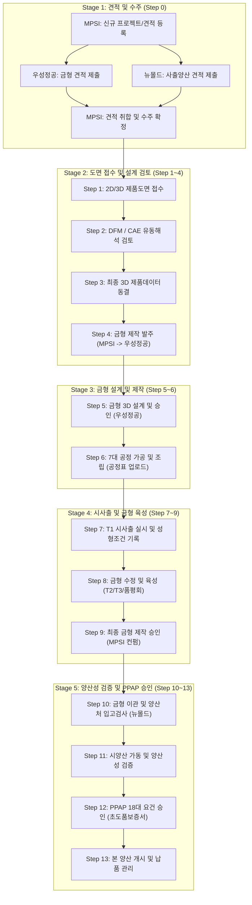

# MPSI 스마트 제조 협업 포털 - 프로세스 기반 사용자 매뉴얼
**문서 버전**: v2.6  
**표준 규격**: 국가기술표준원 KS X 9101-1:2025 (제조분야 기업업무시스템 간 데이터 교환 모델 준용)  
**적용 플랫폼**: MPSI ARCFORGE Platform (MPSI 본사, 우성정공, 뉴몰드)

---

## 1. 개요 및 4대 권한(Role) 정의

MPSI 플랫폼은 원청 고객사(완성차 1차사 등)로부터 접수된 제품 데이터를 기반으로 **금형 견적/설계/제작/T1 시사출**부터 **사출 양산성 검증/PPAP 승인/양산 납품**까지의 전 공정(총 14개 단계: Step 0 ~ Step 13)을 3자 협업(MPSI 본사 ↔ 금형제작처 ↔ 사출양산처) 체계로 통합 제어하는 SCM 플랫폼입니다.

### 4대 권한 체계 및 역할 매트릭스

| 권한 코드 | 소속 기관/업체 | 사용자 직책 (기본값) | 핵심 역할 및 권한 범위 | 기본 접속 메뉴 |
| :--- | :--- | :--- | :--- | :--- |
| **`MPSI`** | **MPSI 본사** | 총괄 관제 PM / 사업총괄 | • 프로젝트 마스터 생성 및 총괄 진척 관리 • 원청 고객사 견적서 발행 및 외주 견적 취합/낙찰 • 금형/양산 협력사 작업 승인 및 공정 병목 통제 • 외주 공급망 데이터 실시간 관제 | `/portal/project` (프로젝트 관리대장) |
| **`VENDOR_MOLD`** | **우성정공(주)** | 금형기술개발팀 팀장 | • 금형 제작 견적서 작성 및 세부 원가 제출 • 제품 3D 데이터 검토 및 DFM/금형설계 협의록 제출 • 7대 가공 공정(건드릴~조립) 일정표 등록 및 진척 관리 • T1 시사출 실시 및 성형조건/외관·치수 육성 결과 입력 | `/portal/vendor-portal/mold/projects` (금형 협력사 프로젝트 관리) |
| **`VENDOR_MASS`** | **(주)뉴몰드** | 사출품질팀 팀장 | • 사출 양산 단가 견적서 제출 • 사출 양산성 사전 타당성 검토(DFA/성형성 검토) • T1 시사출 입회 및 금형 수령/입고 검사 • 시양산(Step 11) 진행 및 **PPAP 18대 서류 승인 제출** | `/portal/vendor-portal/mass/projects` (양산 협력사 프로젝트 관리) |
| **`ADMIN`** | **시스템관리국** | 시스템 최고관리자 | • 사용자 계정 등록/수정/암호 초기화 • 권한별 메뉴 접근 권한 및 매트릭스 제어 • 대분류/그룹메뉴/서브메뉴 동적 CRUD 편집 • 전 권한 포털 화면 통합 조회 및 모니터링 | `/portal/project` (전체 관리자 모드) |

---

## 2. 전체 라이프사이클 프로세스 흐름도 (Step 0 ~ Step 13)

---

## 3. 단계별 상세 업무 매뉴얼

### [Stage 1] 견적 및 수주 관리 (Step 0)

#### 0-1. MPSI 본사: 신규 금형 견적 의뢰 등록 및 발송
* **수행 메뉴**: `[금형-개발 관리] ➡️ [1. 금형 견적 관리] (/portal/mold-dev/quotation)`
* **수행 주체**: `MPSI`
* **수행 절차**:
  1. 우측 상단의 **`[+ 신규 금형 견적 등록]`** 버튼을 클릭합니다.
  2. 견적 대상 프로젝트 번호(예: `MI26005P0`), 프로젝트명, 제품명, 고객사(예: 현대자동차 1차사)를 선택 또는 입력합니다.
  3. 사양 정보(성형기 톤수, 원재료 수지, 캐비티 수, 게이트 방식, 금형강재)를 입력합니다.
  4. 기술 근거자료(2D 도면, 제품 3D 모델, 고객 요구사양서)를 첨부하고 기술 메모를 작성합니다.
  5. 배포 금형처(우성정공(주))를 지정한 후 **`[외주제작 견적요청 발송]`** 버튼을 누릅니다.
* **시스템 결과**:
  * 상태가 `견적요청`으로 등록되며, 우성정공 포털로 견적 요청 데이터가 실시간 전송됩니다.

#### 0-2. 우성정공: 금형 견적서 작성 및 제출
* **수행 메뉴**: `[금형 협력사] ➡️ [금형 견적 관리] (/portal/vendor-portal/mold/quotation)`
* **수행 주체**: `VENDOR_MOLD`
* **수행 절차**:
  1. 견적 목록에서 MPSI가 발송한 `견적요청` 상태의 항목을 찾아 **`[견적 제출]`** 버튼을 클릭합니다.
  2. 금형 제작 견적 총액(원)과 제작 소요일수(예: 45일), 목표 T1 일자를 입력합니다.
  3. 세부 원가 항목(재료비, 가공비, 일반관리비/이윤) 및 제작 특이사항 메모를 작성합니다.
  4. 회사 직인이 날인된 견적서 파일(PDF/Excel)을 첨부한 뒤 **`[견적서 제출]`**을 클릭합니다.
* **시스템 결과**:
  * 상태가 `외주견적제출`로 갱신되고 MPSI 관제 화면에 견적서가 도착합니다.

#### 0-3. 뉴몰드: 사출 양산 견적서 제출
* **수행 메뉴**: `[양산 협력사] ➡️ [양산 견적 관리] (/portal/vendor-portal/mass/quotation)`
* **수행 주체**: `VENDOR_MASS`
* **수행 절차**:
  1. 배정된 양산 견적 의뢰 건을 확인하고 **`[견적서 작성]`**을 클릭합니다.
  2. 제품 단위당 사출 가공비, 원재료비, 포장/물류비, 목표 C/T(초)를 산정하여 제출합니다.

#### 0-4. MPSI 본사: 견적 검토 및 수주 확정
* **수행 메뉴**: `[금형-개발 관리] ➡️ [1. 금형 견적 관리] (/portal/mold-dev/quotation)`
* **수행 주체**: `MPSI`
* **수행 절차**:
  1. 우성정공과 뉴몰드가 제출한 견적 금액 및 납기를 비교 검토합니다.
  2. 원청 고객사 협의 후 **`[수주확정 (발주승인)]`** 버튼을 클릭합니다.
* **시스템 결과**:
  * 프로젝트가 정식 수주(`isContractConfirmed: true`) 상태로 전환되며, 프로젝트 마스터 번호(`MI...`)가 활성화됩니다.
  * 금형/양산 협력사의 **[프로젝트 관리]** 대장에 해당 건이 본 공정 관리 대상으로 정식 등재됩니다.

---

### [Stage 2] 도면 접수 및 설계 검토 (Step 1 ~ Step 4)

#### Step 1: 제품 2D/3D 데이터 접수
* **수행 메뉴**: `[금형-개발 관리] ➡️ [2. 제품검토 및 금형설계] (/portal/mold-dev/design)`
* **수행 주체**: `MPSI`
* 고객사로부터 접수된 2D 승인도, 3D CAD 모델(STEP, CATIA), 수축율/공차 요구조건을 프로젝트 마스터에 업로드합니다.

#### Step 2: DFM 및 CAE 유동해석 검토
* **수행 주체**: `MPSI` ↔ `우성정공`
* 언더컷 유무, 파팅라인(P/L), 구배각도(Draft Angle), 게이트 위치, 예상 변형 및 웰드라인을 분석합니다.
* 보완이 필요한 경우 고객사에 제품 설계 변경(R&R) 요청을 전달합니다.

#### Step 3: 최종 제품 3D 데이터 수신 및 동결 (Freeze)
* 고객사 승인을 거쳐 금형 제작의 기준이 되는 최종 제품 3D 데이터를 확정하고 동결합니다.

#### Step 4: 금형 제작 정식 발주
* **수행 주체**: `MPSI`
* 동결된 3D 데이터와 T1 납기, 금형 사양서를 첨부하여 우성정공(주)으로 정식 금형 제작 발주서를 발송합니다.

---

### [Stage 3] 금형 설계 및 제작 (Step 5 ~ Step 6)

#### Step 5: 금형 3D 설계 및 승인
* **수행 메뉴**: `[금형 협력사] ➡️ [금형 설계 관리] (/portal/vendor-portal/mold/design)`
* **수행 주체**: `우성정공` ➡️ `MPSI 승인`
* **수행 절차**:
  1. 우성정공 설계팀에서 3D 금형 상세 설계(몰드베이스, 코어/캐비티, 슬라이드코어, 냉각 채널, 이젝터 핀 배치)를 진행합니다.
  2. 금형제작협의록 및 3D 금형설계 데이터를 업로드합니다.
  3. MPSI 금형기술팀이 설계를 최종 승인(Confirm)합니다.

#### Step 6: 7대 공정 가공 및 금형 제작
* **수행 메뉴**: `[금형 협력사] ➡️ [금형 제작 관리] (/portal/vendor-portal/mold/manufacture)`
* **수행 주체**: `우성정공`
* **수행 절차**:
  1. 7대 핵심 가공 공정의 진척률(%)을 실시간으로 업데이트합니다:
     * ① **건드릴 (Gun Drill)**: 냉각 유로 가공
     * ② **밀링 (Milling)**: 황삭 및 플레이트 가공
     * ③ **열처리 (Heat Treatment)**: 코어 강재 경도 확보
     * ④ **CNC 정밀가공**: 코어/캐비티 정밀 형상 절삭
     * ⑤ **방전 가공 (EDM)**: 미세 리브 및 방전 형상 가공
     * ⑥ **래핑/사상 (Polishing)**: 성형면 조도 및 경면 사상
     * ⑦ **습합 및 조립 (Assembly)**: 상/하원판 맞춤 및 조립 완료
  2. 주간 **`[금형 제작 공정일정표(Excel)]`**를 시스템에 업로드하여 MPSI에 진척 현황을 공유합니다.

---

### [Stage 4] 시사출 육성 및 금형 승인 (Step 7 ~ Step 9)

#### Step 7: T1 시사출 실시 및 성형조건 기록
* **수행 메뉴**: `[금형 협력사] ➡️ [시사출/금형 육성] (/portal/vendor-portal/mold/trial)`
* **수행 주체**: `우성정공` (입회: `MPSI`, `뉴몰드`)
* **수행 절차**:
  1. 금형 조립 완료 후 지정된 톤수의 사출기에서 최초 T1 시사출을 진행합니다.
  2. T1 성형 조건(수지온도, 사출압력, 보압, 냉각시간, 사이클타임 C/T)을 기록합니다.
  3. 초도 사출품의 육안 검사(미성형, 플래시, 수축, 가스자국) 및 핵심 치수 측정 결과를 등록합니다.

#### Step 8: 금형 수정 및 육성 (T2, T3 품평회)
* 문제 부위에 대한 용접/방전/치수 수정을 진행하고 T2, T3 시사출을 통해 품질을 안정화합니다.

#### Step 9: 최종 금형 제작 승인
* 목표 C/T 달성 및 치수 검사가 합격되면 MPSI가 **`[금형 제작 완료 승인]`**을 처리합니다.

---

### [Stage 5] 양산성 검증 및 PPAP 승인 (Step 10 ~ Step 13)

#### Step 10: 금형 이관 및 양산처 입고 검사
* **수행 메뉴**: `[양산 협력사] ➡️ [양산 협력사 입고] (/portal/vendor-portal/mass/delivery)`
* **수행 주체**: `뉴몰드`
* 우성정공에서 운송된 금형을 (주)뉴몰드 사출공장에 입고하고, 금형 외관, 온수구 배관, 리밋 스위치, 안전장치를 검수하여 입고 확인을 등록합니다.

#### Step 11: 시양산 가동 및 양산성 검증
* **수행 메뉴**: `[양산 협력사] ➡️ [양산성 검증] (/portal/vendor-portal/mass/validation)`
* **수행 주체**: `뉴몰드`
* 연속 성형 테스트(예: 300~500 Shot)를 통해 공정능력(Cpk ≥ 1.33)과 불량률을 검증합니다.

#### Step 12: 양산승인 (PPAP) - 18대 요건 제출 및 최종 승인
* **수행 메뉴**: `[양산 협력사] ➡️ [PPAP 승인 관리] (/portal/vendor-portal/mass/ppap)`
* **수행 주체**: `뉴몰드` ➡️ `MPSI`
* **수행 절차**:
  1. 완성차 품질 표준 PPAP Level 3 필수 요건 서류를 첨부/체크합니다:
     * ① 설계기록 (Design Records)
     * ② 설계 FMEA (DFMEA)
     * ③ 공정흐름도 (Process Flow Chart)
     * ④ 공정 FMEA (PFMEA)
     * ⑤ 관리계획서 (Control Plan)
     * ⑥ 측정시스템분석 (MSA / 게이지 R&R)
     * ⑦ 전수 치수 측정 결과 (Dimensional Results)
     * ⑧ 재료 및 성능 시험성적서 (Material/Performance Test)
     * ⑨ 초기 공정능력 연구 (Initial Process Studies / Cpk)
     * ⑩ 검사기준서 및 한도견본 (Appearance Approval Report)
     * ⑪ **부품제출보증서 (PSW: Part Submission Warrant)**
  2. 뉴몰드가 서류 취합 후 **`[PPAP 승인 요청]`**을 발송합니다.
  3. MPSI 품질본부에서 적합성 판정 후 **`[PPAP 최종 승인]`**을 완료합니다.

#### Step 13: 본 양산 가동 및 실시간 배송/납품
* **수행 메뉴**: `[배송현황] (/portal/delivery-status)`
* 정식 양산 라인에서 양산품을 생산하고, 출하 일자 및 송장 번호를 등록하여 공급망 관제를 유지합니다.
