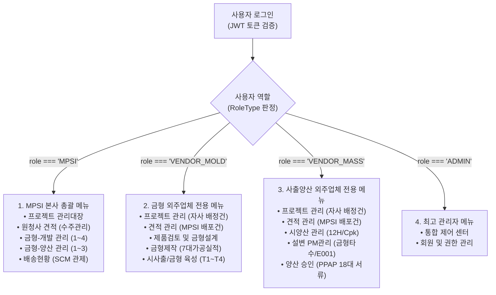

# [MPSI 시스템] 역할 기반 메뉴 구조 및 접근 권한 설정 명세서 (RBAC Specification)

> **문서 목적**: 본 문서는 MPSI(본사) - 금형제작 외주업체 - 사출양산 외주업체 간 다자간 협업 환경에서, **로그인 사용자의 권한(Role)에 따라 메뉴 구조를 물리적으로 격리하여 노출**하고, 타 권한의 메뉴 및 데이터에 접근할 수 없도록 통제하는 **역할 기반 접근 제어(RBAC: Role-Based Access Control) 및 동적 메뉴 아키텍처**를 규정합니다.  
> **대상자**: 프론트엔드 개발자, 백엔드 개발자, 시스템 아키텍트 및 시스템 컨버팅을 수행하는 타 AI.

---

## 1. 사용자 역할(Role) 정의 및 테넌트 식별 체계

시스템의 사용자는 다음 4가지 역할(`RoleType`) 중 하나로 분류되며, 로그인 세션/JWT 토큰에 반드시 해당 정보가 바인딩되어야 합니다.

| 역할 코드 (`RoleType`) | 역할 한글명 | 대표 계정/업체 예시 | 시스템 관제 범위 |
| :--- | :--- | :--- | :--- |
| **`MPSI`** | **MPSI 본사 총괄 관리자** | MPSI 본사 (김민수 총괄이사) | Step 0~13 전 공정 통합 관제, 전사 목표 예산/원가 열람, 외주업체 지정 견적 배포 |
| **`VENDOR_MOLD`** | **금형제작 외주 협력사** | 우성정공(주), 대한금형정공 등 | 금형 개발 파트(Step 1~10), 자사 배정 금형 견적서 작성, 가공 실적/T1 시사출 등록 |
| **`VENDOR_MASS`** | **사출양산 외주 협력사** | (주)뉴몰드, 세원사출(주) 등 | 사출 양산 파트(Step 11~13), 자사 배정 사출 견적서 작성, 12H 연속사출/PPAP/금형 PM |
| **`ADMIN`** | **시스템 최고 관리자** | IT 시스템 운영팀 | 전사 사용자 계정 관리, 권한 부여, 표준 코드 및 사전(Dictionary) 관리 |

### 사용자 세션 토큰 규격 (JWT Payload 예시)
```json
{
  "userId": "user-001",
  "userName": "배희섭 수석",
  "enterpriseId": "WOOSUNG_PRECISION",
  "role": "VENDOR_MOLD",
  "vendorName": "우성정공(주)",
  "vendorType": "OUTSOURCING",
  "exp": 1774000000
}
```

---

## 2. 역할별 메뉴 구조 (Role-Based Menu Trees)

> [!IMPORTANT]
> **메뉴 완전 격리 원칙 (Zero-Exposure Principle)**  
> 로그인한 사용자의 역할에 해당하는 메뉴만 사이드바에 렌더링되어야 하며, 타 역할의 메뉴는 **숨김 처리(Hidden)가 아닌 DOM 트리 자체에서 생성되지 않아야 합니다.**



---

### [메뉴 세부 명세 1] MPSI 본사 총괄 관리자 (`MPSI`)

MPSI 본사 계정으로 로그인한 경우 노출되는 메뉴 목록입니다.

| 대메뉴 (1depth) | 소메뉴 (2depth) | 라우트 URL 경로 | 주요 기능 및 업무 목적 |
| :--- | :--- | :--- | :--- |
| **프로젝트 관리** | 프로젝트 관리대장 | `/portal/project` | 14단계(Step 0~13) 전 프로젝트 상태 매트릭스 통합 관제, 단계별 승인 |
| **금형-견적관리** | 원청사 견적 (수주관리) | `/portal/quotation` | 원청 RFQ 접수, 임시번호(`Q26001-01`) 관리, 정식수주(`MI26001P0`) 승격 |
| **금형-개발 관리(자체/외주)** | 1. 금형 견적 관리 | `/portal/mold-dev/quotation` | 금형 외주처(우성정공 등) 견적 의뢰 배포, 목표 예산 및 네고 심의 |
| | 2. 제품검토 및 금형설계 | `/portal/mold-dev/design` | 고객 도면 배포, DFM/CAE 검토, 외주사 금형 3D 조립도 검도 승인 |
| | 3. 금형제작 | `/portal/mold-dev/manufacture` | 외주사 7대 가공 공정률 모니터링, 공정 사진 및 주간 일정표 확인 |
| | 4. 시사출/금형 육성 및 승인 | `/portal/mold-dev/trial` | T1~T4 시사출 성적서 검토, MPSI 입회 검사, Pass/Fail 판정 루프 통제 |
| **금형-양산 관리(자체/외주)** | 1. 양산 견적 관리 | `/portal/mass-prod/quotation` | 사출 양산처((주)뉴몰드 등) 견적 의뢰 배포, C/T 및 임가공비 협의 |
| | 2. 양산성 검증/시양산 | `/portal/mass-prod/validation` | 12H 연속사출 결과 검증, Cpk ≥ 1.33 심사, 긴급 금형수정 발행 |
| | 3. 양산 승인(PPAP) | `/portal/mass-prod/ppap` | PPAP 18대 품질요건 검토 및 부품제출보증서(PSW) 승인, 양산 PO 생성 |
| **배송현황** | - (단독 메뉴) | `/portal/delivery-status` | 협력사 출하부터 고객사 도착까지의 SCM 표준 물류 흐름 모니터링 |

---

### [메뉴 세부 명세 2] 금형 외주업체 (`VENDOR_MOLD`)

우성정공(주), 대한금형정공 등 **금형제작 협력사 계정으로 로그인한 경우 노출**되는 전용 메뉴입니다.  
MPSI 본사의 원가 관리, 양산 관리 메뉴는 **일체 노출되지 않습니다.**

| 대메뉴 (1depth) | 라우트 URL 경로 | 주요 기능 및 외주업체 업무 권한 |
| :--- | :--- | :--- |
| **프로젝트 관리** | `/portal/vendor-portal/mold/projects` | **자사에 배정된 금형 프로젝트만 조회** (타사 프로젝트 절대 차단), 가공률/일정 실시간 확인 |
| **견적 관리** | `/portal/vendor-portal/mold/quotation` | MPSI가 배포한 견적 의뢰 확인, **자사 4대 금형비(재료/가공/관리/특수) 입력 및 견적서 제출** |
| **제품검토 및 금형설계** | `/portal/vendor-portal/mold/design` | MPSI가 배포한 제품 3D 모델(STEP) 다운로드, **자사 작성 금형 3D 조립도(STP) 업로드** |
| **금형제작** | `/portal/vendor-portal/mold/manufacture` | **7대 가공 공정(건드릴, 밀링, 열처리, CNC, 방전, 래핑, 조립) 진행률 등록** 및 공정 사진 업로드 |
| **시사출/금형 육성** | `/portal/vendor-portal/mold/trial` | **T1 시사출 조건표(온도/압력/CT) 입력**, CMM 치수성적서 등록, MPSI 수정 지시사항 조치 |

---

### [메뉴 세부 명세 3] 사출양산 외주업체 (`VENDOR_MASS`)

(주)뉴몰드, 세원사출(주) 등 **사출양산 협력사 계정으로 로그인한 경우 노출**되는 전용 메뉴입니다.  
MPSI 본사의 전체 프로젝트 관리, 금형 설계/제작 상세 메뉴는 **일체 노출되지 않습니다.**

| 대메뉴 (1depth) | 라우트 URL 경로 | 주요 기능 및 외주업체 업무 권한 |
| :--- | :--- | :--- |
| **프로젝트 관리** | `/portal/vendor-portal/mass/projects` | **자사에 배정된 사출 프로젝트만 조회**, Cpk 검증 현황 및 누적 납품 수량 추적 |
| **견적 관리** | `/portal/vendor-portal/mass/quotation` | MPSI가 배포한 양산 견적 확인, **수지 단가/목표 C/T 기반 EA당 납품단가 계산서 제출** |
| **시양산 관리** | `/portal/vendor-portal/mass/validation` | **12H 연속 사출 실적(Shot수, Cpk, 불량률) 등록**, 금형 문제 시 우성정공 긴급 금형수정 요청 |
| **설변 PM관리** | `/portal/vendor-portal/mass/revision` | **금형 누적 타수 등록 및 1~30차 정기 PM(예방보전) 점검표 작성**, E001 설계변경 이력 관리 |
| **양산 승인(PPAP 승인)** | `/portal/vendor-portal/mass/ppap` | **PPAP 18대 품질서류(관리계획서, 초도품검사, MSA 등) 파일 업로드** 및 승인 요청 |

---

### [메뉴 세부 명세 4] 최고 관리자 (`ADMIN`)

시스템 설정 및 권한 관리를 담당하는 마스터 계정 메뉴입니다.

| 대메뉴 (1depth) | 라우트 URL 경로 | 주요 기능 |
| :--- | :--- | :--- |
| **통합 제어 센터** | `/portal/admin` | 서버 상태, 실시간 접속자, 시스템 로그 및 이상 감지 |
| **회원 및 권한 관리** | `/portal/admin/users` | 사용자 계정 생성, 회사/역할(`MPSI`, `VENDOR_MOLD`, `VENDOR_MASS`) 매핑 및 비밀번호 초기화 |

---

## 3. 프론트엔드 동적 사이드바 구현 표준

프론트엔드 사이드바 컴포넌트(`src/components/app-sidebar.tsx`)에서는 사용자의 로그인 상태를 구독하여 **역할별 메뉴 배열을 단일 진입점에서 교체(Switching)**해야 합니다.

### 사이드바 메뉴 분기 표준 코드 (TypeScript / React)

```tsx
// src/components/app-sidebar.tsx (발췌)
export function AppSidebar() {
  const { role, vendorName } = useAuthRole(); // 로그인 세션 훅

  // 1. 역할에 따른 메뉴 배열 동적 결정
  let activeMenus: NavigationMenuItem[] = mpsiMenus;
  let portalTitle = "MPSI SCM";
  let portalSubTitle = "본사 총괄 관제";
  let themeColorClass = "text-sky-600";

  if (role === "VENDOR_MOLD") {
    activeMenus = vendorMoldMenus;
    portalTitle = vendorName || "금형제작처";
    portalSubTitle = "금형제작 협력사 포털";
    themeColorClass = "text-purple-600";
  } else if (role === "VENDOR_MASS") {
    activeMenus = vendorMassMenus;
    portalTitle = vendorName || "사출양산처";
    portalSubTitle = "사출양산 협력사 포털";
    themeColorClass = "text-emerald-600";
  } else if (role === "ADMIN") {
    activeMenus = adminMenus;
    portalTitle = "MPSI 시스템";
    portalSubTitle = "최고 관리자";
    themeColorClass = "text-amber-600";
  }

  // 2. 결정된 activeMenus만 반복 렌더링 (타 역할 메뉴는 DOM에서 완전 제외)
  return (
    <Sidebar>
      <SidebarHeader>
        <span className={themeColorClass}>{portalTitle}</span>
        <span className="text-xs text-zinc-400">{portalSubTitle}</span>
      </SidebarHeader>
      <SidebarContent>
        {activeMenus.map((menu) => (
          <SidebarMenuItem key={menu.title}>
            {/* 메뉴 렌더링 로직 */}
          </SidebarMenuItem>
        ))}
      </SidebarContent>
    </Sidebar>
  );
}
```

---

## 4. 백엔드 및 라우트 레벨 보안 가드 (Route Guard & API Interceptor)

> [!CAUTION]
> 사이드바 메뉴 숨김만으로는 보안이 완성되지 않습니다. 사용자가 브라우저 URL 창에 직접 주소를 입력하거나 REST API를 호출할 때 **인가(Authorization) 실패 시 403 Forbidden 에러를 반환**해야 합니다.

### 1) Next.js 미들웨어 라우트 가드 (`middleware.ts`)

```typescript
// middleware.ts 예시
import { NextResponse } from "next/server";
import type { NextRequest } from "next/server";

export function middleware(req: NextRequest) {
  const token = req.cookies.get("auth_token")?.value;
  const user = decodeToken(token); // JWT 디코딩
  const path = req.nextUrl.pathname;

  // 1. 금형 외주사(/portal/vendor-portal/mold/*) 영역 접근 통제
  if (path.startsWith("/portal/vendor-portal/mold")) {
    if (user.role !== "VENDOR_MOLD" && user.role !== "MPSI" && user.role !== "ADMIN") {
      return NextResponse.redirect(new URL("/auth/unauthorized", req.url));
    }
  }

  // 2. 사출 외주사(/portal/vendor-portal/mass/*) 영역 접근 통제
  if (path.startsWith("/portal/vendor-portal/mass")) {
    if (user.role !== "VENDOR_MASS" && user.role !== "MPSI" && user.role !== "ADMIN") {
      return NextResponse.redirect(new URL("/auth/unauthorized", req.url));
    }
  }

  // 3. MPSI 본사 전용 영역 접근 통제 (외주사 진입 원천 차단)
  const mpsiOnlyPaths = ["/portal/project", "/portal/quotation", "/portal/mold-dev", "/portal/mass-prod"];
  if (mpsiOnlyPaths.some((p) => path.startsWith(p))) {
    if (user.role !== "MPSI" && user.role !== "ADMIN") {
      return NextResponse.redirect(new URL("/portal/vendor-portal/redirect", req.url));
    }
  }

  return NextResponse.next();
}
```

### 2) 백엔드 REST API RBAC 데코레이터 (NestJS 예시)

```typescript
// 백엔드 컨트롤러 예시
@Controller("api/mold-quotation")
@UseGuards(JwtAuthGuard, RolesGuard)
export class MoldQuotationController {

  // MPSI 본사만 신규 견적 의뢰 배포 가능
  @Post("distribute")
  @Roles("MPSI")
  async distributeEstimate(@Body() dto: DistributeEstimateDto) {
    return this.service.distribute(dto);
  }

  // 금형 외주사는 자사에 배정된 건만 조회 가능
  @Get("vendor-list")
  @Roles("VENDOR_MOLD")
  async getVendorEstimates(@Req() req) {
    const currentVendor = req.user.vendorName;
    return this.service.findAssignedToVendor(currentVendor);
  }
}
```

---

## 5. 데이터베이스 쿼리 레벨 테넌트 격리 지침

외주 협력사가 API를 호출했을 때, DB 레벨에서도 반드시 자사 데이터만 조회되도록 SQL 조건을 강제합니다:

```sql
-- [금형 외주업체 우성정공 조회 시 강제 필터링]
SELECT * 
FROM "MpsiMoldQuotation"
WHERE "AssignedVendors" @> '["우성정공(주)"]'::jsonb
   OR "AssignedVendors" @> '["전체 업체"]'::jsonb
   OR "VendorName" LIKE '%우성정공%';

-- [타사 견적가 마스킹]
-- 타사에서 제출한 단가는 NULL 또는 비공개 처리하고 오직 자사 제출 단가만 프로젝션
```

---

## 6. 🤖 타 AI 인수인계용 프롬프트 지시문 (AI Prompt Template)

다른 AI(Claude, ChatGPT, Gemini 등)에게 본 권한 구조를 바탕으로 개발을 지시할 때 아래 텍스트를 그대로 복사하여 전달하십시오:

````markdown
# [지시서] MPSI 제조 SCM 포털 역할 기반 동적 메뉴 및 접근 제어(RBAC) 구현

당신은 엔터프라이즈 멀티테넌트 웹 애플리케이션 전문 수석 풀스택 개발자입니다. 첨부된 `권한설정.md` 명세서를 기반으로, 로그인한 사용자의 역할(`RoleType`)에 따라 메뉴와 라우트를 철저히 분기하는 시스템을 구현해 주십시오.

### 필수 준수 요건
1. **역할 정의**:
   - `MPSI`: 본사 총괄 (14단계 프로젝트 관리대장, 원청 견적, 외주 견적 배포 등 5대 대메뉴)
   - `VENDOR_MOLD`: 금형 협력사 (자사 배정 프로젝트, 금형 견적서 제출, 조립도 업로드, 7대 가공실적, T1 시사출 등록)
   - `VENDOR_MASS`: 사출 협력사 (자사 배정 프로젝트, 사출 견적서 제출, 12H 연속사출/Cpk, 타수 PM/설변, PPAP 18대 서류)
   - `ADMIN`: 시스템 최고 관리자 (회원 및 권한 관리)
2. **동적 사이드바 렌더링**:
   - 사용자가 로그인하면 JWT 토큰의 `role` 값을 확인하여 해당 역할에 지정된 메뉴 트리만 사이드바에 렌더링하십시오.
   - 타 역할의 메뉴는 DOM 상에 절대 생성되어서는 안 됩니다.
3. **URL 직접 접근 차단 (Route Guard)**:
   - 외주사가 MPSI 본사 URL(`/portal/project`, `/portal/mold-dev/*`, `/portal/mass-prod/*`)에 접근하거나, 금형사가 사출사 URL에 접근하는 경우 403 에러 또는 자사 포털 홈으로 리다이렉트 처리하십시오.
4. **API 및 데이터 격리**:
   - 외주사 견적 조회 API는 MPSI가 배포한 `assignedVendors`에 자사명이 포함된 건만 반환하도록 구현하십시오.
   - 타사의 제출 견적가, 세부 원가, 첨부 파일은 API 응답에서 철저히 제외(Masking)하십시오.

위 지침에 따라 프론트엔드 라우터/사이드바 컴포넌트와 백엔드 인증 가드 코드를 완성해 주십시오.
````

